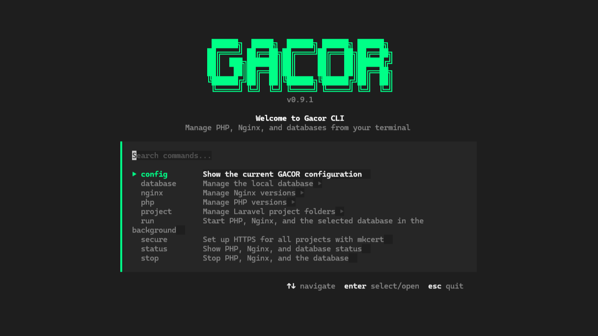

<p align="center">
  
</p>

<p align="center">
  <a href="README.md">English</a> •
  <a href="README_ID.md">Bahasa Indonesia</a>
</p>

<h3 align="center">GACOR-CLI</h3>

<p align="center">
  A local development environment manager for Windows.
  <br />
  Manage PHP, web servers, databases, and projects directly from your terminal.
</p>


<p align="center">
  
  <a href="https://github.com/Abduls27/Gacor-CLI/releases/latest"></a>
  <a href="https://github.com/Abduls27/Gacor-CLI/blob/main/LICENSE"></a>
</p>

## Requirements & Installation

GACOR currently targets **Windows x64**. Open PowerShell and run this command to install the latest release:

```powershell
irm https://raw.githubusercontent.com/Abduls27/Gacor-CLI/main/install.ps1 | iex
```

The installer downloads the latest `gacor.exe` release to `%USERPROFILE%\.gacor` (or the directory set by `GACOR_HOME`) and adds that directory to your User `PATH`. Open a new terminal after installation, then run `gacor`.

The generated `uninstall.ps1` removes the entire install directory recursively. Back up any configuration, database data, certificates, or other files in `GACOR_HOME` before using it.

For Laravel/PHP projects that require HTTPS, run `gacor secure` after adding the project directory. The `.test` domain is configured when running `gacor run`. If the domain also requires HTTPS, run `gacor secure` first.

## How It Works

GACOR downloads and manages PHP, Nginx, and an optional selected database server; it does not install Laravel or manage project dependencies. PHP and Nginx versions must be selected before `gacor run`. A database is optional, and GACOR manages one selected database engine/version at a time; that server can contain multiple databases.

Add a **parent directory** containing your Laravel projects with `gacor project add`. Discovery checks only the parent directory's immediate child folders and identifies a project by its `artisan` file; it does not search recursively or detect a Laravel project placed directly in the parent directory. Each detected project is served from its `public` folder at `<folder-name>.test`.

`gacor run` regenerates the selected Nginx version's `conf\nginx.conf`. Manual changes to that generated file can be overwritten the next time `gacor run` executes. GACOR updates the Windows hosts file for detected `.test` domains and requests administrator access when required.

| Service | Default port | Binding |
|---|---:|---|
| PHP FastCGI | 9000 | `127.0.0.1` |
| Nginx HTTP | 80 | All interfaces unless restricted by Windows Firewall |
| Nginx HTTPS | 443 | All interfaces unless restricted by Windows Firewall |
| MySQL | 3306 | `127.0.0.1` |
| MariaDB | 3307 | `127.0.0.1` |
| PostgreSQL | 5432 | `127.0.0.1` |

These ports must be available for the selected services. The generated Nginx configuration does not explicitly bind HTTP/HTTPS to loopback, so do not assume the web server is inaccessible from other devices on the network; use Windows Firewall and trusted networks accordingly.

## Quick Start

The commands below assume `gacor.exe` is on `PATH`. If you are running the binary from the project directory, prefix each command with `.\gacor.exe`.

```powershell
gacor php use
gacor nginx use
gacor project add "C:\Users\Name\Projects"
gacor run
```

Installing a database is optional:

```powershell
gacor database install
```

Run `gacor status` to check services and `gacor stop` to stop them.

## Directory Structure

By default, GACOR stores its configuration and runtime files in `%USERPROFILE%\.gacor`.

Set the `GACOR_HOME` environment variable to use a different directory.

```text
%USERPROFILE%\.gacor\
├── gacor.exe
├── gacor.json                 ← GACOR configuration
├── bin\
│   ├── mkcert.exe             ← downloaded when running `gacor secure`
│   ├── php\
│   │   └── <version>\         ← PHP runtime
│   ├── nginx\
│   │   └── <version>\         ← Nginx runtime and configuration
│   └── database\
│       ├── mysql\<version>\       ← MySQL binaries
│       ├── mariadb\<version>\     ← MariaDB binaries
│       └── postgresql\<version>\ ← PostgreSQL binaries
├── database\                  ← generated database server configuration
├── data\
│   └── database\
│       └── <engine>\<version>\ ← database server data
├── certs\                     ← project HTTPS certificates
├── php.pid
├── nginx.pid
└── database.pid               ← present while a database process is tracked
```

Runtime, data, and certificate directories are created as needed. Database data is stored separately from the database server binaries.

## Interactive Menu

Run `gacor` without arguments to open the interactive menu.

Use the arrow keys to navigate, `Enter` to select an item or open a submenu, `Esc` to go back or exit, and the search field to find commands.

## Comparison

GACOR CLI is designed for developers who prefer managing their PHP development environment directly from the command line (CLI).

| Feature | GACOR CLI | Laragon | Laravel Herd | XAMPP |
|---|---|---|---|---|
| PHP version management | Yes | Yes | Yes | Manual |
| Web server | Nginx | Apache / Nginx | Nginx | Apache |
| MariaDB | Yes | Yes | Herd Pro | Yes |
| MySQL | Yes | Yes | Herd Pro | — |
| PostgreSQL | Yes | Yes | Herd Pro | — |

*Feature availability may vary depending on the edition, configuration, and installed components.*

## Commands

### PHP

```bash
gacor php list             # list available stable PHP versions
gacor php install          # select a stable version to download
gacor php install 8.3.12   # download a specific stable version
gacor php use              # select and activate a PHP version
gacor php use-pre          # download and activate a PHP pre-release
gacor php check            # check installed versions and interactively update one version
gacor php update           # update one installed major.minor line to its latest version
```

`gacor php use-pre` displays available pre-release builds from PHP QA (such as RC, dev, alpha, or beta), then downloads and activates the selected version.

Each command updates at most one installed major.minor line per invocation. `check` removes the superseded version after a successful update; `update` keeps it installed. Updating the active PHP version with `check` requires PHP to be stopped first.

These builds are experimental and may be unstable.

The `install` command only downloads stable releases. Use `use-pre` to install and activate a pre-release version.

### Nginx

```bash
gacor nginx list           # list available versions
gacor nginx install        # select a version to download
gacor nginx install 1.26.3 # download a specific version
gacor nginx use             # select, download if needed, and activate an Nginx version
gacor nginx check           # check for and update to the latest version
```

### Database

```bash
gacor database install      # select an engine and version, then initialize the server
gacor database start        # start the selected database server
gacor database status       # display server status, host, port, and initial database
gacor database stop         # stop the selected database server
gacor database show         # open a menu to view, create, or delete databases
gacor database show toko    # create a database named "toko"
```

The `gacor db` alias can also be used instead of `gacor database`.

During installation, GACOR asks for an initial database name, username, and password. Database servers bind only to `127.0.0.1`. The selected engine, version, database name, username, and port are stored in the GACOR configuration; passwords are not stored, so save them when prompted.

The `show` command automatically starts the database server if it is not already running. Without a name, it opens a menu to list, create, or delete databases. With a name, it creates that database using the configured GACOR user.

Database management through the interactive menu requires the database administrator password. Stopping MySQL or MariaDB may also prompt for it; PostgreSQL shutdown does not require that password.

GACOR refuses to initialize or start a database if its configured port is already in use, rather than connecting to another server on that port. The initial database and user names must be at most 63 ASCII characters, begin with a letter or underscore, and contain only letters, digits, or underscores.

### Laravel Projects

```bash
gacor project                                  # open the project menu
gacor project add "C:\Users\Name\Projects"     # add a parent directory
gacor project change                           # change the discovery directory
gacor project list                             # list detected projects
```

GACOR checks only the immediate child directories of each configured parent directory. A child is detected as a Laravel project if it contains an `artisan` file. Discovery is not recursive.

The project menu offers `add` if no discovery directory has been configured, and `change` once a directory has been added.

### Running the Environment

```bash
gacor run       # start the selected database (if any), PHP, and Nginx
gacor status    # display service status
gacor stop      # stop PHP, Nginx, and the selected database
```

`gacor run` generates virtual host configurations for detected projects using the `<project-folder-name>.test` domain and serves each project's `public` directory.

If necessary, GACOR requests Windows administrator privileges to update the hosts file. GACOR-managed entries are marked in that file; removing or changing project folders does not necessarily remove old marked entries.

Select your PHP and Nginx versions beforehand using the `use` commands. These commands automatically download versions that are not yet installed and activate them.

### HTTPS

```bash
gacor secure    # set up HTTPS certificates for detected projects
```

`gacor secure` installs mkcert's local root CA, creates certificates for detected projects, and regenerates Nginx configuration to redirect HTTP to HTTPS. After setup, run `gacor stop` followed by `gacor run` so Nginx uses the updated configuration. The root CA and certificates are local to this Windows development environment.

### Configuration

```bash
gacor config    # display the configuration summary
```

The configuration file is located at `%USERPROFILE%\.gacor\gacor.json` by default, or inside the directory specified by `GACOR_HOME`. It stores selected versions, database settings, project parent folders, and PHP defaults. Defaults for new PHP installations are four FastCGI workers, a 100M upload limit, a 256M memory limit, and the `Asia/Jakarta` timezone. GACOR creates `php.ini` from PHP's development template; it does not overwrite an existing `php.ini`.

Database passwords are intentionally not saved. Back up `gacor.json`, the `data` directory, and any certificates you need before moving or removing `GACOR_HOME`.

## Credits & Third-Party Binaries

GACOR is an installer and process manager, it doesn't bundle or modify these binaries, just downloads them from their official sources:

- [PHP](https://windows.php.net/download/) (PHP License)
- [Nginx](https://nginx.org/en/download.html) (BSD 2-Clause)
- [mkcert](https://github.com/FiloSottile/mkcert) (BSD 3-Clause)
- [MySQL](https://www.mysql.com/) (GPLv2, by Oracle)
- [MariaDB](https://mariadb.org/) (GPLv2, by MariaDB Foundation)
- [PostgreSQL](https://www.postgresql.org/) (PostgreSQL License)

GACOR itself only automates the download, configuration, and lifecycle management of these tools for local PHP development on Windows. Each third-party component remains subject to its own license.
