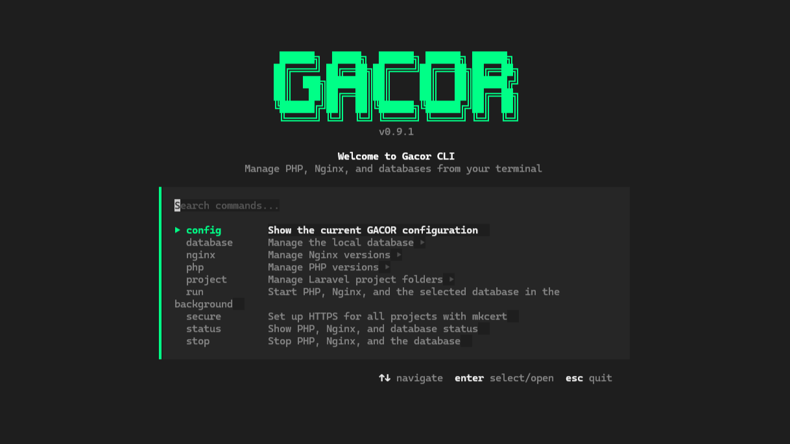

<p align="center">
  
</p>

<p align="center">
  <a href="README.md">English</a> •
  <a href="README_ID.md">Bahasa Indonesia</a>
</p>

<h3 align="center">GACOR-CLI</h3>

<p align="center">
  Manajer lingkungan pengembangan lokal untuk Windows.
  <br />
  Kelola PHP, web server, database, dan project langsung dari terminal.
</p>


[](https://github.com/Abduls27/Gacor-CLI/releases/latest)
[](https://github.com/Abduls27/Gacor-CLI/blob/main/LICENSE)

## Persyaratan & Instalasi

GACOR saat ini ditujukan untuk **Windows x64**. Buka PowerShell dan jalankan perintah berikut untuk menginstal versi rilis terbaru:

```powershell
irm https://raw.githubusercontent.com/Abduls27/Gacor-CLI/main/install.ps1 | iex
```

Installer mengunduh `gacor.exe` versi terbaru dari release ke `%USERPROFILE%\.gacor` (atau ke folder yang ditentukan oleh `GACOR_HOME`) dan menambahkan folder tersebut ke User `PATH`. Buka terminal baru setelah instalasi, lalu jalankan `gacor`.

File `uninstall.ps1` yang dibuat installer akan menghapus seluruh folder instalasi secara rekursif. Cadangkan konfigurasi, data database, sertifikat, dan file lain di `GACOR_HOME` sebelum menjalankannya.

Untuk project Laravel/PHP yang membutuhkan HTTPS, jalankan `gacor secure` setelah menambahkan folder project. Domain `.test` disiapkan saat menjalankan `gacor run`. Jika domain tersebut juga membutuhkan HTTPS, jalankan `gacor secure` terlebih dahulu.

## Cara Kerja

GACOR mengunduh dan mengelola PHP, Nginx, serta satu server database opsional yang dipilih; GACOR tidak menginstal Laravel atau mengelola dependency project. Versi PHP dan Nginx harus dipilih sebelum menjalankan `gacor run`. Database bersifat opsional, dan GACOR mengelola satu engine/versi database terpilih pada satu waktu; server tersebut dapat berisi beberapa database.

Tambahkan **folder induk** yang berisi project Laravel dengan `gacor project add`. Pendeteksian hanya memeriksa folder anak langsung dari folder induk dan mengenali project melalui file `artisan`; pencarian tidak rekursif dan project Laravel yang berada langsung di folder induk tidak akan terdeteksi. Setiap project yang terdeteksi dilayani dari folder `public` dengan domain `<nama-folder>.test`.

`gacor run` membuat ulang `conf\nginx.conf` untuk versi Nginx terpilih. Perubahan manual pada file tersebut dapat tertimpa saat `gacor run` berikutnya dijalankan. GACOR memperbarui Windows hosts file untuk domain `.test` yang terdeteksi dan meminta akses administrator jika diperlukan.

| Service | Port default | Binding |
|---|---:|---|
| PHP FastCGI | 9000 | `127.0.0.1` |
| Nginx HTTP | 80 | Semua interface, kecuali dibatasi Windows Firewall |
| Nginx HTTPS | 443 | Semua interface, kecuali dibatasi Windows Firewall |
| MySQL | 3306 | `127.0.0.1` |
| MariaDB | 3307 | `127.0.0.1` |
| PostgreSQL | 5432 | `127.0.0.1` |

Port tersebut harus tersedia untuk service yang dipilih. Konfigurasi Nginx yang dibuat GACOR tidak mengikat HTTP/HTTPS secara eksplisit ke loopback. Jadi, jangan menganggap web server tidak dapat diakses perangkat lain di jaringan; sesuaikan Windows Firewall dan gunakan hanya di jaringan tepercaya.

## Mulai Cepat

Perintah di bawah mengasumsikan `gacor.exe` sudah ada di `PATH`. Jika menjalankan binary dari folder project, awali setiap perintah dengan `.\gacor.exe`.

```powershell
gacor php use
gacor nginx use
gacor project add "C:\Users\Nama\Projects"
gacor run
```

Instalasi database bersifat opsional:

```powershell
gacor database install
```

Jalankan `gacor status` untuk memeriksa service dan `gacor stop` untuk menghentikannya.

## Struktur Folder

Secara default, konfigurasi dan runtime GACOR disimpan di `%USERPROFILE%\.gacor`.

Atur environment variable `GACOR_HOME` jika ingin menggunakan folder lain.

```text
%USERPROFILE%\.gacor\
├── gacor.exe
├── gacor.json                 ← konfigurasi GACOR
├── bin\
│   ├── mkcert.exe             ← diunduh saat menjalankan `gacor secure`
│   ├── php\
│   │   └── <versi>\           ← runtime PHP
│   ├── nginx\
│   │   └── <versi>\           ← runtime dan konfigurasi Nginx
│   └── database\
│       ├── mysql\<versi>\       ← binary MySQL
│       ├── mariadb\<versi>\     ← binary MariaDB
│       └── postgresql\<versi>\ ← binary PostgreSQL
├── database\                  ← konfigurasi server database yang dibuat GACOR
├── data\
│   └── database\
│       └── <engine>\<versi>\ ← data server database
├── certs\                     ← sertifikat HTTPS project
├── php.pid
├── nginx.pid
└── database.pid               ← ada saat proses database tercatat
```

Folder runtime, data, dan sertifikat dibuat sesuai fitur yang digunakan. Data database disimpan terpisah dari binary server database.

## Menu Interaktif

Jalankan `gacor` tanpa argumen untuk membuka menu interaktif.

Gunakan tombol panah untuk navigasi, `Enter` untuk memilih atau membuka submenu, `Esc` untuk kembali atau keluar, dan kolom pencarian untuk mencari perintah.

## Perbandingan

GACOR CLI dirancang untuk developer yang ingin mengelola lingkungan pengembangan PHP langsung melalui command line (CLI).

| Fitur | GACOR CLI | Laragon | Laravel Herd | XAMPP |
|---|---|---|---|---|
| Manajemen versi PHP | Ya | Ya | Ya | Manual |
| Web server | Nginx | Apache / Nginx | Nginx | Apache |
| MariaDB | Ya | Ya | Herd Pro | Ya |
| MySQL | Ya | Ya | Herd Pro | — |
| PostgreSQL | Ya | Ya | Herd Pro | — |

*Ketersediaan fitur dapat berbeda tergantung edisi, konfigurasi, dan komponen yang diinstal.*

## Perintah

### PHP

```bash
gacor php list             # lihat versi PHP stabil yang tersedia
gacor php install          # pilih versi stabil untuk diunduh
gacor php install 8.3.12   # unduh versi stabil tertentu
gacor php use              # pilih dan aktifkan versi PHP
gacor php use-pre          # unduh dan aktifkan versi pre-release PHP
gacor php check            # periksa versi terinstal dan pilih satu versi untuk diperbarui
gacor php update           # perbarui satu lini major.minor ke versi terbarunya
```

`gacor php use-pre` menampilkan pilihan build pre-release dari PHP QA (misalnya RC, dev, alpha, atau beta), kemudian mengunduh dan langsung mengaktifkan versi yang dipilih.

Setiap perintah hanya memperbarui maksimal satu lini major.minor per pemanggilan. `check` menghapus versi lama setelah update berhasil; `update` mempertahankan versi lama tetap terinstal. PHP yang sedang berjalan harus dihentikan sebelum versi aktifnya diperbarui dengan `check`.

Build ini bersifat eksperimental dan mungkin tidak stabil.

Perintah `install` hanya mengunduh versi stabil. Gunakan `use-pre` untuk memasang sekaligus mengaktifkan versi pre-release.

### Nginx

```bash
gacor nginx list           # lihat versi yang tersedia
gacor nginx install        # pilih versi untuk diunduh
gacor nginx install 1.26.3 # unduh versi tertentu
gacor nginx use            # pilih, unduh jika perlu, dan aktifkan versi Nginx
gacor nginx check          # periksa dan perbarui ke versi terbaru
```

### Database

```bash
gacor database install      # pilih engine dan versi, lalu inisialisasi server
gacor database start        # jalankan server database terpilih
gacor database status       # lihat status, host, port, dan database awal
gacor database stop         # hentikan server database terpilih
gacor database show         # buka menu untuk melihat, membuat, atau menghapus database
gacor database show toko    # buat database bernama "toko"
```

Alias `gacor db` juga dapat digunakan sebagai pengganti `gacor database`.

Saat instalasi, GACOR meminta nama database awal, username, dan password. Server database hanya bind ke `127.0.0.1`. Engine, versi, nama database, username, dan port terpilih disimpan di konfigurasi GACOR; password tidak disimpan, jadi simpan password saat diminta.

Perintah `show` otomatis menjalankan server jika belum aktif. Tanpa nama, perintah ini membuka menu untuk melihat daftar, membuat, atau menghapus database. Dengan nama, perintah ini membuat database tersebut menggunakan user GACOR yang dikonfigurasi.

Pengelolaan database melalui menu interaktif memerlukan password administrator database. Penghentian MySQL atau MariaDB juga dapat meminta password tersebut; PostgreSQL tidak memerlukannya untuk berhenti.

GACOR menolak inisialisasi atau menjalankan database jika port yang dikonfigurasi sedang digunakan, alih-alih terhubung ke server lain pada port itu. Nama database dan user awal maksimal 63 karakter ASCII, harus diawali huruf atau underscore, serta hanya boleh berisi huruf, angka, dan underscore.

### Project Laravel

```bash
gacor project                                  # buka menu project
gacor project add "C:\Users\Nama\Projects"     # tambahkan folder induk
gacor project change                           # ganti folder discovery
gacor project list                             # tampilkan project yang terdeteksi
```

GACOR hanya memeriksa folder anak langsung dari setiap folder induk yang ditambahkan. Folder anak dianggap project Laravel jika berisi file `artisan`. Pendeteksian tidak rekursif.

Menu project menawarkan `add` jika belum ada folder discovery, dan `change` setelah folder ditambahkan.

### Menjalankan Environment

```bash
gacor run       # jalankan database terpilih (jika ada), PHP, dan Nginx
gacor status    # lihat status service
gacor stop      # hentikan PHP, Nginx, dan database terpilih
```

`gacor run` membuat konfigurasi virtual host untuk project yang ditemukan, menggunakan domain `<nama-folder-project>.test`, dan menyajikan folder `public` setiap project.

Jika diperlukan, GACOR meminta izin administrator Windows untuk memperbarui hosts file. Entri yang dikelola GACOR diberi penanda; menghapus atau mengganti folder project belum tentu menghapus entri lama yang ditandai.

Pilih versi PHP dan Nginx terlebih dahulu menggunakan perintah `use`. Perintah tersebut akan mengunduh versi yang belum terpasang sekaligus mengaktifkannya.

### HTTPS

```bash
gacor secure    # siapkan sertifikat HTTPS untuk project yang ditemukan
```

`gacor secure` memasang root CA lokal mkcert, membuat sertifikat untuk project yang terdeteksi, dan membuat ulang konfigurasi Nginx agar HTTP dialihkan ke HTTPS. Setelah setup, jalankan `gacor stop` lalu `gacor run` agar Nginx menggunakan konfigurasi terbaru. Root CA dan sertifikat hanya untuk lingkungan development Windows lokal ini.

### Konfigurasi

```bash
gacor config    # tampilkan ringkasan konfigurasi
```

File konfigurasi secara default berada di `%USERPROFILE%\.gacor\gacor.json`, atau di folder yang ditentukan melalui environment variable `GACOR_HOME`. File ini menyimpan versi terpilih, pengaturan database, folder induk project, dan default PHP. Default untuk instalasi PHP baru adalah empat worker FastCGI, batas upload 100M, batas memory 256M, dan timezone `Asia/Jakarta`. GACOR membuat `php.ini` dari template development PHP dan tidak menimpa `php.ini` yang sudah ada.

Password database memang tidak disimpan. Cadangkan `gacor.json`, folder `data`, dan sertifikat yang diperlukan sebelum memindahkan atau menghapus `GACOR_HOME`.

## Kredit & Binary Pihak Ketiga

GACOR adalah installer dan process manager,  nggak membundel atau memodifikasi binary ini, cuma mengunduhnya dari sumber resmi masing-masing:

- [PHP](https://windows.php.net/download/) (PHP License)
- [Nginx](https://nginx.org/en/download.html) (BSD 2-Clause)
- [mkcert](https://github.com/FiloSottile/mkcert) (BSD 3-Clause)
- [MySQL](https://www.mysql.com/) (GPLv2, by Oracle)
- [MariaDB](https://mariadb.org/) (GPLv2, by MariaDB Foundation)
- [PostgreSQL](https://www.postgresql.org/) (PostgreSQL License)

GACOR sendiri hanya mengotomasi proses download, konfigurasi, dan lifecycle management tool-tool di atas untuk kebutuhan local development PHP di Windows. Masing-masing komponen pihak ketiga tetap tunduk pada lisensinya sendiri.